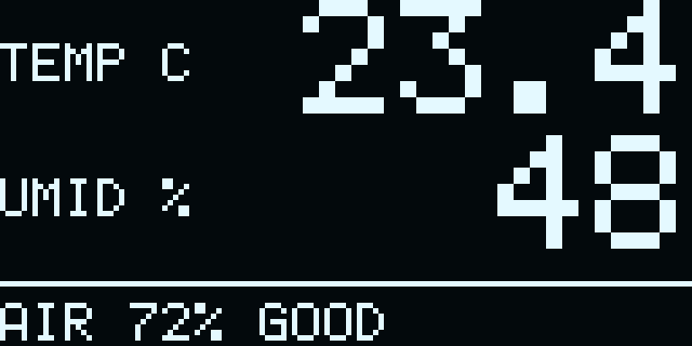
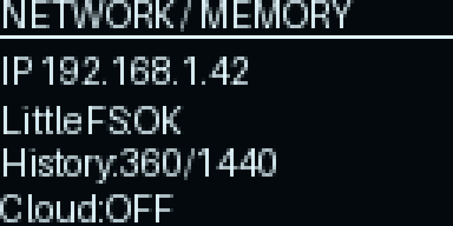

# SENTINEL MICRO V8.0

Monitor ambientale compatto per postazioni maker.  
Compact environmental monitor for maker workspaces.

- [Manuale / User guide](MANUAL_IT-EN.md)
- [Presentazione / Presentation](SENTINEL_MICRO_V8.0_Presentation_IT-EN.pptx)
- [Sketch Arduino](SENTINEL_MICRO_V8_0/SENTINEL_MICRO_V8_0.ino)

ESP32-C3 Super Mini · BME280 · MQ-135 · SH1106 · WS2812B

**Franco Ghinzani**

## Schermate OLED / OLED screens

Simulazioni del display SH1106 con valori e IP di esempio.  
SH1106 display simulations with sample readings and an example IP address.

**Temperatura, umidità e indice aria / Temperature, humidity and air index**

**Rete e indirizzo IP / Network and IP address**

